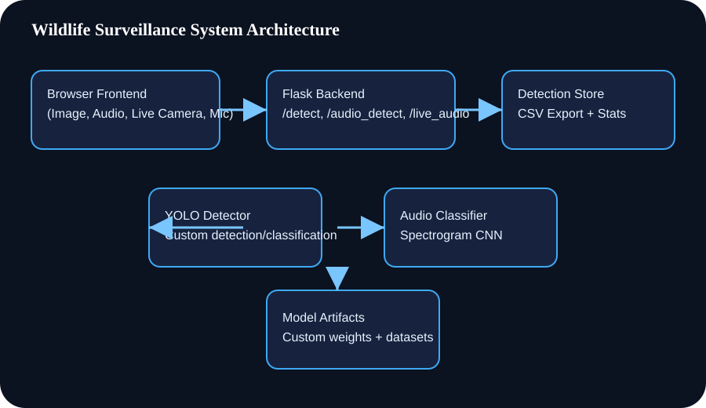
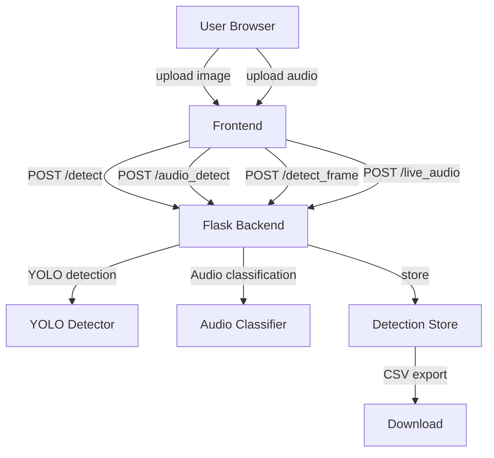
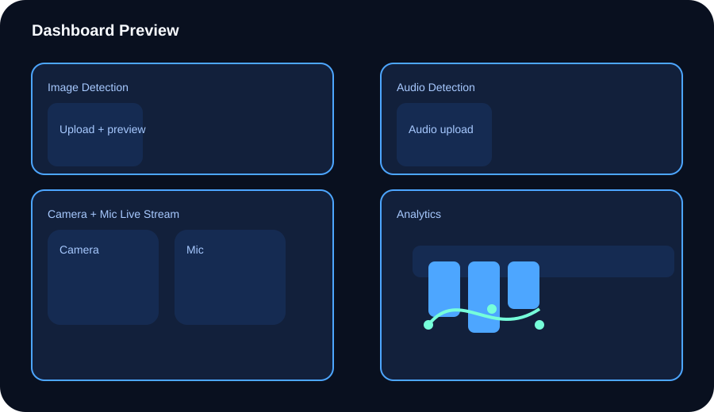

# Wildlife Surveillance Monitoring System HUB



## Overview

Wildlife Surveillance Monitoring System HUB is a hybrid monitoring platform built to detect animals in both image and audio data. It supports:

- Static image animal detection with bounding boxes and labels.
- Audio file classification for wildlife sounds.
- Live webcam frame detection.
- Live microphone signal classification with noise gating.
- In-memory event tracking and CSV export.

## Features

- **Image detection** via YOLO-based models and custom-trained classifiers.
- **Audio detection** using dual-channel spectrogram CNNs.
- **Live dashboards** for camera and mic activity.
- **Analytics** charts for animal detection counts.
- **Export** detections as CSV for review.

## Repository Structure

```text
BACKEND/
  app.py
  config.py
  requirements.txt
  models/
  utils/
  training/
frontend/
  app.js
  index.html
  style.css
AUDIO_DATASET/
IMAGES_DATASET/
assets/
requirements.txt
requirements.freeze.txt
README.md
LICENSE
.gitignore
```

## System Architecture



### Architecture Notes

- `BACKEND/app.py` exposes REST endpoints for image/audio detection, live streaming, and stats.
- `BACKEND/models/yolo_detector.py` loads a custom YOLO detector or custom classifier model.
- `BACKEND/models/audio_classifier.py` loads audio CNNs for spectrogram classification.
- `BACKEND/utils/detection_store.py` stores detection events and exports CSV rows.

## Frontend



The frontend in `frontend/` provides:

- Image upload and preview.
- Audio upload and playback.
- Live camera selection and detection overlay.
- Live microphone visualizer and detection feedback.
- Analytics charts powered by detection statistics.

## Installation

1. Create and activate a virtual environment:

```bat
cd V:nimal_Sound_Detect
python -m venv venv
venv\Scriptsctivate.bat
```

2. Install backend dependencies:

```bat
pip install -r BACKEND
equirements.txt
```

3. Run the backend:

```bat
cd BACKEND
python app.py
```

4. Open the frontend by loading `frontend/index.html` in your browser.

## Requirements

- `requirements.txt` contains the intended backend dependency set.
- `requirements.freeze.txt` contains the locally frozen package versions present in this environment.

> Note: Some packages may require a compatible Python version or prebuilt wheels on Windows. If installing fails, try Python 3.11 or use a conda environment.

## License

This repository is licensed under the Apache License 2.0.
